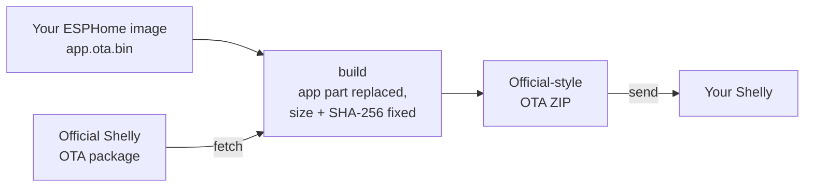

<h1 align="left">
  
  Free-Shelly OTA<br>
  <sup><sup><sub>Pack your own ESPHome firmware into an official-style Shelly OTA package — and send it to the device.</sub></sup></sup>
</h1>

[![Status][status-shield]][status-url]
[![Version][version-shield]][version-url]
[![Issues][issues-shield]][issues-url]
[![License][license-shield]][license-url]

[Supported devices](#supported-devices) · [Download](https://github.com/oxynatOr/free-shelly-ota/releases) · [Quick start](#quick-start) · [Step-by-step guide](docs/guide.md) · [Documentation](#documentation) · [Docs site](https://oxynator.github.io/free-shelly-ota/) · [Contributing](CONTRIBUTING.md) · [Request a device](https://github.com/oxynatOr/free-shelly-ota/issues/new?template=new-device.yml)

`free-shelly-ota` is a command-line tool for **Shelly Gen2 (ESP32)**, **Gen3 (ESP32-C3)** and **Gen4 (ESP32-C6)** devices.
It turns your ESPHome firmware into an update the Shelly accepts, and sends it over the network:

1. **`fetch`** downloads the official OTA package for your device from Shelly.
2. **`build`** replaces its `app` part with your ESPHome image and fixes size and SHA-256 in the manifest.
3. **`send`** checks the device, serves the ZIP from this PC and triggers the update over RPC.



**No UART needed to install.** Keep one ready as your way back, see the warning below.

> [!WARNING]
> **Experimental.** The whole chain is confirmed on real devices only where the table below shows ✅.
>
> - **Keep UART access ready.** A bootloader that does not suit a device can only be fixed over UART
>   ([Recovery over UART](docs/recovery-uart.md)).
> - **Warranty.** Installing third-party firmware voids your Shelly warranty.
> - **Risk.** Incorrect flashing can brick your device. You assume all responsibility.

> [!NOTE]
> This project is **not** affiliated with Shelly, Allterco Robotics, Schneider Electric, ESPHome, CSA or Espressif Systems.
>
> It contains **no ESPHome binaries and no Shelly firmware**: you compile your own ESPHome image, and `fetch` downloads the
> official package from Shelly.


## Supported devices

**60 profiles:** ✅ 10 confirmed · 🟡 8 partly checked · 🔬 12 DevKit-tested · 🧪 30 untested

Click the profile for the device page: ESPHome config, the exact commands and what to expect. This table shows the devices that ran on
real hardware (✅ and 🟡). All profiles, also the DevKit-tested (🔬) and the untested (🧪) ones, are on the
[device pages](docs/devices/README.md#devices).

| Device | Profile | Chip | State | Note |
| --- | --- | --- | --- | --- |
| Plus Plug S (V2 hardware, Gen2) | [`PlusPlugS`](docs/devices/PlusPlugS.md) | ESP32 | ✅ | Flashed without UART |
| Plus Plug IT (Gen2) | [`PlusPlugIT`](docs/devices/PlusPlugIT.md) | ESP32 | ✅ | Flashed without UART |
| Plus i4 / i4 DC (Gen2) | [`PlusI4`](docs/devices/PlusI4.md) | ESP32 | 🟡 | Flashed over OTA; the inputs and the LED not checked |
| Plus Uni (Gen2) | [`PlusUni`](docs/devices/PlusUni.md) | ESP32 | 🟡 | Flashed over OTA, ESPHome's bootloader step not checked |
| Plug M Gen3 | [`PlugMG3`](docs/devices/PlugMG3.md) | ESP32&#8209;C3 | ✅ | |
| Plug S Gen3 | [`PlugSG3`](docs/devices/PlugSG3.md) | ESP32&#8209;C3 | ✅ | |
| H&T Gen3 | [`HTG3`](docs/devices/HTG3.md) | ESP32&#8209;C3 | ✅ | |
| PM Mini Gen3 | [`MiniPMG3`](docs/devices/MiniPMG3.md) | ESP32&#8209;C3 | ✅ | Measures only, no relay |
| Multicolor Bulb E27 Gen3 | [`RGBCCTBulbG3`](docs/devices/RGBCCTBulbG3.md) | ESP32&#8209;C3 | ✅ | |
| Mini 1 Gen3 | [`Mini1G3`](docs/devices/Mini1G3.md) | ESP32&#8209;C3 | ✅ | |
| 1 Gen3 | [`S1G3`](docs/devices/S1G3.md) | ESP32&#8209;C3 | ✅ | |
| 2PM Gen3 | [`S2PMG3`](docs/devices/S2PMG3.md) | ESP32&#8209;C3 | ✅ | Relays and meter not reported |
| Plug M Gen3, beta layout | [`PlugMG3-beta`](docs/devices/PlugMG3.md#beta-layout) | ESP32&#8209;C3 | 🟡 | Shelly 2.2.0-beta2 only |
| Plug PM Gen3 | [`PlugPMG3`](docs/devices/PlugPMG3.md) | ESP32&#8209;C3 | 🟡 | Flashed over OTA, readings not checked. Measures only, no relay |
| Duo Bulb Gen3 | [`DuoBulbG3`](docs/devices/DuoBulbG3.md) | ESP32&#8209;C3 | 🟡 | Flashed over OTA and runs; the GPIOs (PWM, from the stock dump) are not confirmed on the hardware |
| Mini 1PM Gen3 | [`Mini1PMG3`](docs/devices/Mini1PMG3.md) | ESP32&#8209;C3 | 🟡 | Flashed over OTA (two units); a second OTA, the relay under load and the meter not checked |
| 1PM Gen3 | [`S1PMG3`](docs/devices/S1PMG3.md) | ESP32&#8209;C3 | 🟡 | Flashed over OTA with the reporter's own tooling, not `ota.py`; meter not checked |
| Power Strip 4 Gen4 | [`PowerStrip`](docs/devices/PowerStrip.md) | ESP32&#8209;C6 | 🟡 | Boots, outlets not checked |

> - ✅ The whole chain ran on a real device.
> - 🟡 Flashed on a real device, but part of the chain or of the function is not checked yet (see the Note column).
> - 🔬 The OTA ran through on a dev board with the [DevKit image](docs/devkit.md), but not on the real device yet.
> - 🧪 The package builds and verifies, but nobody has flashed it yet.


## What you need

- A Shelly of a supported model that still runs **Shelly's own firmware**, and its IP address (or this PC on its access point).
- **Python 3.10 or newer** on a PC that the Shelly can reach on your network.
- **ESPHome** (the `esphome` command) or **Docker** to compile your firmware.
- **A way back:** a UART adapter ([build one from a dev board](docs/recovery-uart.md#build-your-own-uart-adapter)). A bad flash can only be fixed over UART.

The rule that makes it work: the package ships **ESPHome's bootloader**, and the installer has to write the app to **slot 0** ([why](docs/bootloader-and-slots.md)). `send` checks both and tells you what to do.


## Quick start

New to this? The [Step-by-step guide](docs/guide.md) covers everything from checking the device to the way back. The short version:

**Download.** Get the [latest release](https://github.com/oxynatOr/free-shelly-ota/releases) (*Source code (zip)*) and unpack it, or run `git clone https://github.com/oxynatOr/free-shelly-ota`, then `pip install -r requirements.txt`.

**1. Write your ESPHome config.** It must use Shelly's partition table and offset. Copy `partitions/<Profile>-stock.csv` from
this repository next to your YAML (one per device; the device page lists the offset). Without it `build` refuses.

```yaml
esp32:
  partitions: PlugMG3-stock.csv              # the copied file
  framework:
    type: esp-idf
    sdkconfig_options:
      CONFIG_PARTITION_TABLE_OFFSET: "0x10000"   # per device: see its page
    advanced:
      enable_ota_rollback: false
ota:
  - platform: esphome
    allow_partition_access: true
```

**2. Compile and pack.** `--compile` runs ESPHome for you (the `esphome` command, else Docker; the first Docker compile downloads the toolchain, see [Compile](docs/commands.md#compile)).

```
# download the official package
python ota.py fetch PlugMG3 --insecure

# compile your config and put the app into the package; the ZIP goes to out/
python ota.py build PlugMG3 --compile my-plug.yaml
```

Compiled it yourself? Give `build` the two files ESPHome wrote: `python ota.py build PlugMG3 app.ota.bin --esphome-factory app.factory.bin --esphome-yaml my-plug.yaml`.

**3. Send it.**

```
python ota.py send PlugMG3 out/PlugMG3-app-<date>.zip --ip <device IP>
```

- `PlugMG3` is the example; use your device's profile from the table above.
- `--insecure` is needed because Shelly's servers use a private CA; the hash in the download URL still guards against transfer errors ([`fetch`](docs/commands.md#fetch)).
- Add `--dry-run` first to check the device without sending anything ([`send`](docs/commands.md#send)).
- A device without Wi-Fi (Zigbee firmware) needs [`ble wifi`](docs/commands.md#ble) first.

> [!CAUTION]
> The package wipes NVS (Wi-Fi and settings), and a package built from your config can contain your Wi-Fi password.
> Never share or commit the ZIP ([Credential check](docs/credential-check.md)). While `send` runs, its temporary web server
> hands the ZIP to anyone on your network who asks for its exact file name, so use a network you trust.


## Documentation

Start with the [Step-by-step guide](docs/guide.md). The same pages are on the [documentation site](https://oxynator.github.io/free-shelly-ota/), with search. The [documentation index](docs/README.md) lists everything; the pages you will need most:

| Page | What is in it |
| --- | --- |
| [Step-by-step guide](docs/guide.md) | The whole way: check, prepare, config, build, send, afterwards, failure, way back |
| [Device pages](docs/devices) | One page per device: config, pins, commands, log lines, pitfalls |
| [Commands](docs/commands.md) | `fetch`, `build`, `send`, `restore`, `ble`, `log` and the rest, with all options |
| [Troubleshooting](docs/troubleshooting.md) | Header errors, empty log, battery devices, eFuse, power cycle |
| [Recovery over UART](docs/recovery-uart.md) | Back to Shelly OS with `esptool` |
| [Bootloader and slots](docs/bootloader-and-slots.md) | Why ESPHome's bootloader is shipped, `min_version`, why the app must land in slot 0 |
| [Developer guide](docs/guide-developers.md) | Adding devices, testing, reports, release |
| [CHANGELOG](CHANGELOG.md) · [Roadmap](ROADMAP.md) | What changed, what is planned and where testers can help |


## Contributing and reports

Your device is not in the table, or you flashed one? Please tell us, also when it worked. A device needs a **profile** (made from the official package, takes minutes); what takes time is a hardware test.

- [Request a device](https://github.com/oxynatOr/free-shelly-ota/issues/new?template=new-device.yml); it helps most if you offer to test it.
- [Open a device report](https://github.com/oxynatOr/free-shelly-ota/issues/new?template=device-report.yml) and attach the file `send --log-file` writes. [Report a bug](https://github.com/oxynatOr/free-shelly-ota/issues/new?template=bug.yml) if the tool misbehaved.
- Make the profile yourself: `python ota.py add-device <official.zip>`, see [Device profiles](devices/README.md#adding-a-profile).
- Code, docs and AI-assisted work are welcome when they are checked: [CONTRIBUTING.md](CONTRIBUTING.md).

> [!CAUTION]
> Please do not attach flash dumps or built ZIPs to an issue: they can contain your Wi-Fi password and per-device secrets.


## Credits

This project builds on the research of others: [tasmota/mgos32-to-tasmota32](https://github.com/tasmota/mgos32-to-tasmota32) (GPL-3.0),
[inventor7777/ESPHome-Shelly-Plus-Plug-US](https://github.com/inventor7777/ESPHome-Shelly-Plus-Plug-US) (MIT) and
[automatous-io/shelly-gen4-esphome](https://github.com/automatous-io/shelly-gen4-esphome) (Apache-2.0). Please visit and support them.
The tool's own findings (the loader's boot state, the slot rule, `min_version`, the pin tables, the DevKit) were worked out here and on real
devices, with the help of the people who tested and reported. [CREDITS.md](CREDITS.md) names them all and says what each contributed.


## License

Distributed under the [Apache License 2.0](LICENSE); see also [NOTICE](NOTICE).
Section 6 of the license grants no rights to any trademark: Shelly, ESPHome, Espressif and the other names used here
belong to their owners, and this project has nothing to do with them beyond working with their products.


<!-- MARKDOWN LINKS & IMAGES -->
[status-shield]: https://img.shields.io/badge/status-experimental-orange.svg?style=flat-square
[status-url]: #supported-devices
[version-shield]: https://img.shields.io/github/v/tag/oxynatOr/free-shelly-ota.svg?style=flat-square&label=version
[version-url]: https://github.com/oxynatOr/free-shelly-ota/tags
[issues-shield]: https://img.shields.io/github/issues/oxynatOr/free-shelly-ota.svg?style=flat-square
[issues-url]: https://github.com/oxynatOr/free-shelly-ota/issues
[license-shield]: https://img.shields.io/github/license/oxynatOr/free-shelly-ota.svg?style=flat-square
[license-url]: https://github.com/oxynatOr/free-shelly-ota/blob/main/LICENSE
