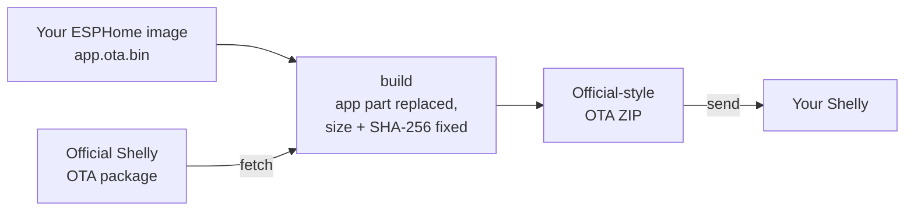

<h1 align="left">
  
  Free-Shelly OTA<br>
  <sup><sup><sub>Pack your own ESPHome firmware into an official-style Shelly OTA package — and send it to the device.</sub></sup></sup>
</h1>

[![Status][status-shield]][status-url]
[![Version][version-shield]][version-url]
[![Issues][issues-shield]][issues-url]
[![License][license-shield]][license-url]

[Supported devices](#supported-devices) · [Download](https://github.com/oxynatOr/free-shelly-ota/releases) · [Quick start](#quick-start) · [Documentation](#documentation) · [Request a device](https://github.com/oxynatOr/free-shelly-ota/issues/new?template=new-device.yml)

`free-shelly-ota` is a command-line tool for **Shelly Gen2 (ESP32)**, **Gen3 (ESP32-C3)** and **Gen4 (ESP32-C6)** devices.
It turns your ESPHome firmware into an update the Shelly accepts, and sends it over the network:

1. **`fetch`** downloads the official OTA package for your device from Shelly.
2. **`build`** replaces its `app` part with your ESPHome image and fixes size and SHA-256 in the manifest.
3. **`send`** checks the device, serves the ZIP from this PC and triggers the update over RPC.



**No UART needed to install.** Keep one ready as your way back, see the warning below.

> [!WARNING]
> **Experimental.** The whole chain is confirmed on real devices only where the table below shows ✅.
>
> - **Keep UART access ready.** A bootloader that does not suit a device can only be fixed over UART
>   ([Recovery over UART](docs/recovery-uart.md)).
> - **Warranty.** Installing third-party firmware voids your Shelly warranty.
> - **Risk.** Incorrect flashing can brick your device. You assume all responsibility.

> [!NOTE]
> This project is **not** affiliated with Shelly, Allterco Robotics, Schneider Electric, ESPHome, CSA or Espressif Systems.
>
> It contains **no ESPHome binaries and no Shelly firmware**: you compile your own ESPHome image, and `fetch` downloads the
> official package from Shelly.


## Supported devices

**43 profiles:** ✅ 10 confirmed · 🟡 7 partly checked · 🔬 7 DevKit-tested · 🧪 19 untested

Click the profile for the device page: ESPHome config, the exact commands and what to expect. This table shows the devices that ran on
real hardware (✅ and 🟡). All profiles, also the DevKit-tested (🔬) and the untested (🧪) ones, are on the
[device pages](docs/devices/README.md#devices).

| Device | Profile | Chip | State | Note |
| --- | --- | --- | --- | --- |
| Plug M Gen3 | [`PlugMG3`](docs/devices/PlugMG3.md) | ESP32&#8209;C3 | ✅ | |
| Plug M Gen3, beta layout | [`PlugMG3-beta`](docs/devices/PlugMG3.md#beta-layout) | ESP32&#8209;C3 | 🟡 | Shelly 2.2.0-beta2 only |
| Plug S Gen3 | [`PlugSG3`](docs/devices/PlugSG3.md) | ESP32&#8209;C3 | ✅ | |
| Plug PM Gen3 | [`PlugPMG3`](docs/devices/PlugPMG3.md) | ESP32&#8209;C3 | 🟡 | Flashed over OTA, readings not checked. Measures only, no relay |
| H&T Gen3 | [`HTG3`](docs/devices/HTG3.md) | ESP32&#8209;C3 | ✅ | |
| PM Mini Gen3 | [`MiniPMG3`](docs/devices/MiniPMG3.md) | ESP32&#8209;C3 | ✅ | Measures only, no relay |
| Multicolor Bulb E27 Gen3 | [`RGBCCTBulbG3`](docs/devices/RGBCCTBulbG3.md) | ESP32&#8209;C3 | ✅ | |
| Duo Bulb Gen3 | [`DuoBulbG3`](docs/devices/DuoBulbG3.md) | ESP32&#8209;C3 | 🟡 | Flashed over OTA and runs; the GPIOs (PWM, from the stock dump) are not confirmed on the hardware |
| Power Strip 4 Gen4 | [`PowerStrip`](docs/devices/PowerStrip.md) | ESP32&#8209;C6 | 🟡 | Boots, outlets not checked |
| Plus Plug S (V2 hardware, Gen2) | [`PlusPlugS`](docs/devices/PlusPlugS.md) | ESP32 | ✅ | Flashed without UART |
| Plus Plug IT (Gen2) | [`PlusPlugIT`](docs/devices/PlusPlugIT.md) | ESP32 | ✅ | Flashed without UART |
| Mini 1 Gen3 | [`Mini1G3`](docs/devices/Mini1G3.md) | ESP32&#8209;C3 | ✅ | |
| 1 Gen3 | [`S1G3`](docs/devices/S1G3.md) | ESP32&#8209;C3 | ✅ | |
| Mini 1PM Gen3 | [`Mini1PMG3`](docs/devices/Mini1PMG3.md) | ESP32&#8209;C3 | 🟡 | Flashed over OTA (two units); a second OTA, the relay under load and the meter not checked |
| Plus Uni (Gen2) | [`PlusUni`](docs/devices/PlusUni.md) | ESP32 | 🟡 | Flashed over OTA, ESPHome's bootloader step not checked |
| 1PM Gen3 | [`S1PMG3`](docs/devices/S1PMG3.md) | ESP32&#8209;C3 | 🟡 | Flashed over OTA with the reporter's own tooling, not `ota.py`; meter not checked |
| 2PM Gen3 | [`S2PMG3`](docs/devices/S2PMG3.md) | ESP32&#8209;C3 | ✅ | Relays and meter not reported |

> - ✅ The whole chain ran on a real device.
> - 🟡 Flashed on a real device, but part of the chain or of the function is not checked yet (see the Note column).
> - 🔬 The OTA ran through on a dev board with the [DevKit image](docs/devkit.md), but not on the real device yet.
> - 🧪 The package builds and verifies, but nobody has flashed it yet.


## Quick start

**Download.** Get the [latest release](https://github.com/oxynatOr/free-shelly-ota/releases) (*Source code (zip)*) and unpack it, or
run `git clone https://github.com/oxynatOr/free-shelly-ota`. It is a Python tool, nothing to install besides `pip install -r requirements.txt` (step 3).

**1. Write your ESPHome config.** It must use Shelly's partition table and offset. Copy `partitions/<Profile>-stock.csv` from
this repository next to your YAML (one per device; the device page lists the offset). Without it `build` refuses.

```yaml
esp32:
  partitions: PlugMG3-stock.csv              # the copied file
  framework:
    type: esp-idf
    sdkconfig_options:
      CONFIG_PARTITION_TABLE_OFFSET: "0x10000"   # per device: see its page
    advanced:
      enable_ota_rollback: false
ota:
  - platform: esphome
    allow_partition_access: true
```

**2. Compile it.**

```
esphome compile my-plug.yaml
```

Or let the tool do it in step 3 with `--compile my-plug.yaml`: it uses the `esphome` command, else Docker (Docker Desktop has to be running; the first compile downloads the toolchain into a Docker volume and takes a while, later ones are fast, see [Compile](docs/commands.md#compile)).

ESPHome writes two files you need: `firmware.ota.bin` (the app) and `firmware.factory.bin`. Below they are called
`app.ota.bin` and `app.factory.bin`. With `--esphome-factory` the package also carries ESPHome's bootloader, so later
ESPHome OTAs work without extra steps — see [Bootloader and slots](docs/bootloader-and-slots.md).

**3. Pack and send.**

```
pip install -r requirements.txt

# download the official package
python ota.py fetch PlugMG3 --insecure

# put your app into it; the ZIP goes to out/
python ota.py build PlugMG3 app.ota.bin --esphome-factory app.factory.bin --esphome-yaml my-plug.yaml

# send it to the device; progress and the device's confirmation are shown
python ota.py send PlugMG3 out/PlugMG3-app-<date>.zip --ip <device IP>
```

- `PlugMG3` is the example; use your device's profile from the table above.
- `--insecure` is needed because Shelly's servers use a private CA, so TLS verification fails; the hash in the download URL
  still guards against transfer errors ([`fetch`](docs/commands.md#fetch)).
- Without `--ip`, `send` talks to `192.168.33.1`, the Shelly's own access point. Add `--dry-run` first to check the device
  without sending anything ([`send`](docs/commands.md#send)).
- **A device without Wi-Fi** (the Zigbee firmware opens no access point and has no network yet): give it one over Bluetooth first with
  `python ota.py ble wifi <SSID> -`, which asks for the password and prints the address to use as `--ip`. It needs `pip install bleak` and a Bluetooth LE
  adapter ([`ble`](docs/commands.md#ble); seen on one Zigbee unit on a dev board, not yet on a real device).

> [!CAUTION]
> The package wipes NVS (Wi-Fi and settings), and a package built from your config can contain your Wi-Fi password.
> Never share or commit the ZIP ([Credential check](docs/credential-check.md)). While `send` runs, its temporary web server
> hands the ZIP to anyone on your network who asks for its exact file name, so use a network you trust.


## Another device?

A device needs a **profile**, which is made from the official OTA package and takes a few minutes. What takes time is a
hardware test: nobody can say a device works until someone has flashed one.

- **Ask for it:** [request the device](https://github.com/oxynatOr/free-shelly-ota/issues/new?template=new-device.yml). It helps
  most if you offer to test it.
- **Make the profile yourself:** `python ota.py add-device <official.zip>` creates it from an official package
  (`--parent <base device>` for a variant, e.g. the Zigbee version). What a profile contains and what to do next:
  [Device profiles](devices/README.md#adding-a-profile), [`add-device`](docs/commands.md#add-device).
- **Tell us how it went,** also when it worked: [open a device report](https://github.com/oxynatOr/free-shelly-ota/issues/new?template=device-report.yml)
  (choose *Other* for a profile you made yourself) and attach the file `send --log-file` writes.

> [!CAUTION]
> Please do not attach flash dumps or built ZIPs to an issue: they can contain your Wi-Fi password and per-device secrets.


## Documentation

| Page | What is in it |
| --- | --- |
| [Device pages](docs/devices) | One page per device: config, commands, log lines, pitfalls |
| [Commands](docs/commands.md) | `fetch`, `build`, `send`, `restore`, `ble`, `log` and the rest, with all options |
| [Bootloader and slots](docs/bootloader-and-slots.md) | Why ESPHome's bootloader is shipped, `min_version`, why the app must land in slot 0 |
| [Troubleshooting](docs/troubleshooting.md) | Header errors, empty log, battery devices, eFuse, power cycle |
| [Recovery over UART](docs/recovery-uart.md) | Back to Shelly OS with `esptool` |
| [Credential check](docs/credential-check.md) | Secrets inside images and packages |
| [Versions](docs/versions.md) | Tool version, build report, profile revisions |
| [CHANGELOG](CHANGELOG.md) | What changed |
| [Roadmap](ROADMAP.md) | What is planned, and where testers can help |


## Credits

Almost everything this tool knows was found out by other people. Please visit and support their projects. [CREDITS.md](CREDITS.md) has the same list with more detail, and names the people who tested devices and sent reports.

| Project | License | What we learned from it |
| --- | --- | --- |
| [tasmota/mgos32-to-tasmota32](https://github.com/tasmota/mgos32-to-tasmota32) | GPL-3.0 | Converting a Shelly OTA ZIP so the stock updater accepts third-party firmware |
| [inventor7777/ESPHome-Shelly-Plus-Plug-US](https://github.com/inventor7777/ESPHome-Shelly-Plus-Plug-US) | MIT | Replacing only the app image in Shelly's ZIP; the partition table at `0x10000`; the follow-up bootloader step |
| [automatous-io/shelly-gen4-esphome](https://github.com/automatous-io/shelly-gen4-esphome) | Apache-2.0 | Gen4 (ESP32-C6) partition layout, the A/B slot rule, install documentation |
| [jjanssen95](https://github.com/jjanssen95), [815rx1](https://github.com/815rx1), [yasdfgr](https://github.com/yasdfgr) | – | Device reports with logs: Mini 1 Gen3, Plug M Gen3 (the 2.1.0 package, loader 1.0.2) and Plus Uni (loader 1.0.3) |
| [imsandli](https://github.com/imsandli) | – | The first external device report (PM Mini Gen3): a successful OTA run with logs, the BL0942 RX pull-up and voltage calibration, the idea for the reachability check |
| Shelly / Allterco Robotics | – | The official OTA packages and update API (not redistributed here) |
| [ESPHome](https://esphome.io), Espressif (esptool, ESP-IDF) | – | The firmware framework and tooling everything builds on |


## License

Distributed under the [Apache License 2.0](LICENSE); see also [NOTICE](NOTICE).
Section 6 of the license grants no rights to any trademark: Shelly, ESPHome, Espressif and the other names used here
belong to their owners, and this project has nothing to do with them beyond working with their products.


<!-- MARKDOWN LINKS & IMAGES -->
[status-shield]: https://img.shields.io/badge/status-experimental-orange.svg?style=flat-square
[status-url]: #supported-devices
[version-shield]: https://img.shields.io/github/v/tag/oxynatOr/free-shelly-ota.svg?style=flat-square&label=version
[version-url]: https://github.com/oxynatOr/free-shelly-ota/tags
[issues-shield]: https://img.shields.io/github/issues/oxynatOr/free-shelly-ota.svg?style=flat-square
[issues-url]: https://github.com/oxynatOr/free-shelly-ota/issues
[license-shield]: https://img.shields.io/github/license/oxynatOr/free-shelly-ota.svg?style=flat-square
[license-url]: https://github.com/oxynatOr/free-shelly-ota/blob/main/LICENSE
